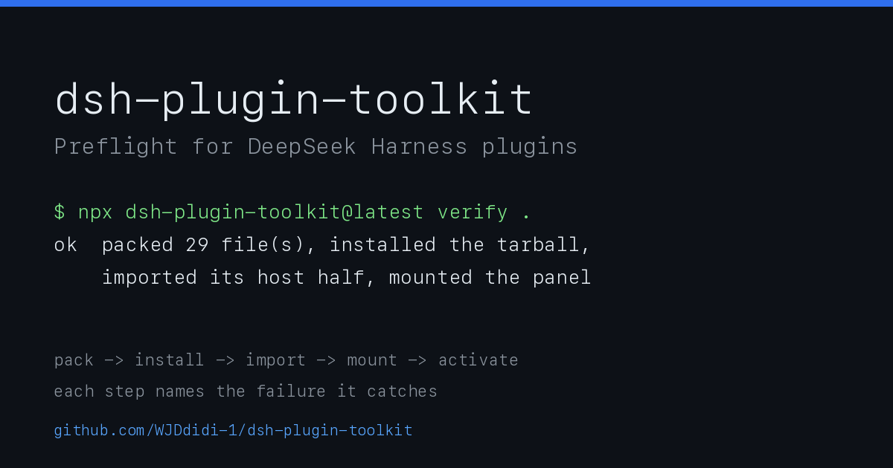
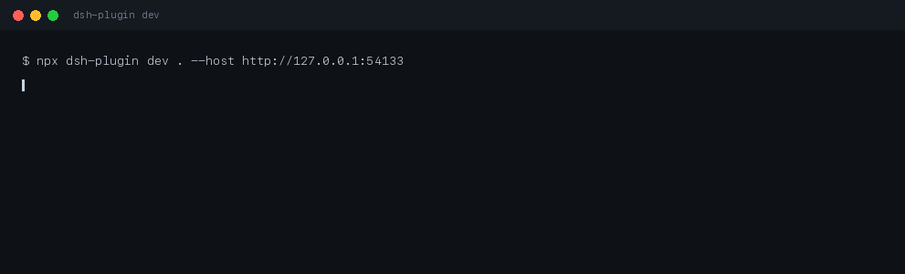

# dsh-plugin-toolkit



A preflight and release tool for [DeepSeek Harness](https://github.com/deepseek-ai/dsh) plugins, plus the pieces of the publishing ritual that kept going wrong by hand.

```
npx dsh-plugin doctor .          # can this plugin be loaded and installed?
npx dsh-plugin index             # does every market-index version state a host range?
npx dsh-plugin release --dry-run # what would shipping this version do?
```

## Requirements

- Node.js 18 or newer (`node --fetch` is used to read the registry; no dependencies)
- Git and `gh` on `PATH` for the steps that touch GitHub
- DeepSeek Harness `>=0.2.0` — the version whose market index carries `engines.dsh`, which is what makes the range check meaningful

## Why this exists

Releasing one plugin fifteen times taught me three things the ecosystem's tooling does not cover:

1. **A version is not shipped when npm accepts it.** Registry propagation took two to eight minutes every time. `npm view` answered from a stale local cache, so I repeatedly believed a release had failed when it had not — and once believed it had succeeded when the market still could not see it.
2. **The market index is a second release, done by hand.** Each version needs an entry carrying `publishTimestamp` from the registry and `engines.dsh` from the manifest. Forget the range and the index validator rejects the PR with `Engines mismatch` — after the tag is already public.
3. **Reading a manifest is not the same as checking it.** A plugin can have a valid `package.json` and still be uninstallable: `files` that omit the entry the manifest points at, a bundle patch that does not exist, a README that never states the host range it declares.


## Start from a plugin that already passes

```sh
$ npx dsh-plugin-toolkit@0.5.0 init ./my-panel --name my-panel --title "My panel"
created 8 file(s) in /Users/you/my-panel
  .github/workflows/ci.yml
  .gitignore
  README.md
  client.js
  cordis.patch.yml
  index.js
  package.json
  test/panel.test.mjs

next: npm install && npm test && npm run doctor
```

What you get is not a snippet: it is a plugin whose `doctor` already passes (`engines.dsh`, the patch file, the `files` list), with a client bundle that registers a sidebar tab, a testkit test for it, and a CI workflow that runs both. `init` refuses a directory that is not empty unless you pass `--force`, and refuses a name npm would refuse — those are the two mistakes that cost the most time later.

## Test a panel without a browser

A plugin's client code is one file that calls `window.__ModuleLoader__.load({factory})` — there is no module to import, so the usual React test setup does not apply. `testkit` supplies the missing half: a DOM, the real React, and a host context that records what the panel registers.

```sh
npm install --save-dev jsdom react react-dom
```

```js
import { mountClient, createFetch } from 'dsh-plugin-toolkit/testkit';

const panel = await mountClient({
  file: 'client.js',
  copy: { 'my-plugin': { title: 'My panel' } },
  fetch: createFetch({
    '/my-plugin/report': { body: { score: 71, noise: 3 } },
    '/my-plugin/apply': () => ({ status: 201, body: { score: 92 } }),
  }),
});

await panel.click('[data-testid="optimize"]');
console.assert(panel.text().includes('92'), 'the score on screen did not move');
console.assert(panel.must('[role="status"]').textContent.includes('92'));
await panel.unmount();
```

`unmount()` is async: it lets React finish the work its own unmount schedules before the DOM goes away. Skipping the `await` surfaces as `ReferenceError: window is not defined` *after* the test has already passed, which is a confusing way to learn it.

What you get back: `text()`, `html()`, `query(selector)`, `must(selector)` (throws with the rendered HTML when it misses), `click(selector)`, `type(selector, value)`, `press(selector, key)`, `focus`, `attributes(selector)`, `snapshot(dir, name)` for a normalised DOM baseline, and `host` for assertions about what the bundle registered.

### Keep a visual baseline

The DOM is the baseline: normalising class order and whitespace gives a file that fails for the reasons a screenshot would — a lost label, a control that stopped rendering — and can be reviewed in a diff instead of by eye.

```js
import { expectSnapshot } from 'dsh-plugin-toolkit/testkit';

const panel = await mountClient({ file: 'client.js' });
expectSnapshot(panel.html(), '__snapshots__', 'panel');   // throws with the element that moved
await panel.unmount();
```

First run writes nothing: it tells you to re-run with `UPDATE_SNAPSHOTS=1`, so a baseline is always a decision, never a side effect.

### Check what assistive tech sees

```js
assert.equal(panel.attributes('[role="tab"][aria-selected="true"]').id, 'tab-protection');
assert.match(panel.must('[role="status"]').textContent, /Score moved 71 → 77/);
```

`must()` throws with the rendered markup when the selector misses, which is the difference between "the assertion failed" and "here is what the user actually got".

Every example below is a file in this repository, run by CI, and the output shown is the output it prints:

| Example | What it shows |
| --- | --- |
| `node examples/mount-a-bundle.mjs` | mount a real bundle, read the text, click, read it again |
| `node examples/route-stubs.mjs` | answer the routes a panel asks for, and assert on the requests |
| `node examples/baseline.mjs` | a DOM baseline compared on every run |
| `node examples/aria.mjs` | what assistive tech sees |

```sh
$ node examples/mount-a-bundle.mjs
Demo panel Count 0 0
Demo panel Count 1 1
```

```sh
$ node examples/route-stubs.mjs
Score 71
asked for: 1 route(s), undeclared route answers 404
```

To look at a bundle by hand:

```sh
npx dsh-plugin mount ./client.js            # print the text a user would see
npx dsh-plugin mount ./client.js --html     # print the markup
```

That is how the AIignore panel was checked before release: the real bundle, mounted in Node, against a stubbed `/aiignore/*`:

```
$ npx dsh-plugin mount ../ai-context-doctor/plugin/client.js
AIignore No workspace yet Could not read the report …
```

## Start from the example

[`dsh-plugin-example`](https://github.com/WJDdidi-1/dsh-plugin-example) is a ~70-line plugin: one sidebar tab, two languages, one behaviour test, CI that runs `doctor` through the composite action. It is the shape this toolkit expects, so it is also the fastest way to see whether the toolkit fits your plugin.

```sh
dsh plugin add dsh-plugin-example
```

## Edit a plugin that is already installed

The host already swaps a rebuilt bundle without a page reload: it watches each plugin's entry artifact and reports a `rebuilt` frame on `/plugins/events`. `dev` puts the new file where the host is looking, then **proves** the frame arrived instead of asking you to check by eye.

```sh
npx dsh-plugin dev . --host http://127.0.0.1:54133
```



*Recorded from a real run against the running app: the last line is the revision the app sent back on `/plugins/events`, not a message the tool printed on faith.*

```
demo-aiignore: /work/plugin/client.js -> ~/.dsh/profiles/desktop/node_modules/dsh-aiignore/client.js
initial: copied 163647 bytes at 1:18:43 AM
reloaded dsh-aiignore (rev e0c0230c4fc9)
watching /work/plugin
```

That last line is the whole point: the revision came back from the app's own event stream, so "it reloaded" is a fact, not a hope.

| Flag | Meaning |
|---|---|
| `--dest <dir>` | write into this installed copy instead of searching `~/.dsh/profiles/*/node_modules/<name>` |
| `--entry <file>` | copy this file instead of `dsh.client.entry`, `client.js`, `lib/client.js` |
| `--build <command>` | run this before each copy (a failed build copies nothing) |
| `--host <url>` | confirm the reload against the app at this URL; without it the copy still happens and the tool says it is unconfirmed |
| `--once` | copy once and exit, for scripts |

Two things it does not do, because the host does not: React state inside the reloaded plugin is lost, and a failed swap does not roll back to the previous bundle.

## Use it in CI

The same checks run as a GitHub Action, so a tag cannot go out on a plugin that would not install:

```yaml
- uses: actions/checkout@v4
- uses: WJDdidi-1/dsh-plugin-toolkit@v1
  with:
    dir: plugin        # the folder holding the plugin's package.json
```

`command: index` audits `market/index.json` instead, and fails on any version that cannot state a host range.

## What `doctor` checks

| Check | Why it matters |
| --- | --- |
| `version` | The tag is built from it; a malformed version produces a tag nobody can install |
| `engines.dsh` | The market index copies this into every version entry. Missing it fails the index PR |
| `readme` | A `Requirements` section that states the declared range, so an install failure is predictable |
| `dsh field` | `dsh.bundle.patch` must exist for the host to load the plugin |
| `patch file` | The path declared above must be a real file |
| `client entry` | If `dsh.client` is declared, the bundle has to be there |
| `files list` | Every path `package.json` points at (`exports`, patch, client) must be covered by `files` |

Exit code is `0` when the plugin can be installed and `1` when it cannot, so it drops into CI unchanged.

## Prove the tarball works, not just the repository

`doctor` reads your working copy. Users install the tarball, and a `files` list can ship everything except the panel — `doctor` will not notice.

```sh
$ npx dsh-plugin-toolkit@0.6.0 verify .
ok  packed 5 file(s), installed the tarball, mounted the panel
    My panel This panel came from dsh-plugin init. Clicks: 0
```

It packs, installs that tarball into a throwaway directory, then mounts the bundle **from the installed copy**. When the `files` list drops the panel:

```sh
$ npx dsh-plugin-toolkit@0.6.0 verify .
dsh-plugin verify: stopped at pack
  ✗ pack: the tarball does not contain client.js, so the installed plugin has no panel
```

## What `release` does

`release` runs the sequence in the order that fails cheapest first:

1. Preflight (`doctor`) — stop before tagging anything.
2. Refuse to run on a dirty tree, or if the tag already exists.
3. Create and push the tag, which starts the plugin's release workflow.
4. Poll the registry until it actually serves that version, reporting each wait.
5. Write the index entry with the publish time **the registry reports**, not the local clock. It waits for `time[version]` specifically: the abbreviated registry document has no `time` field, and an entry with a null timestamp is rejected by the market checker.
6. With `--pr`: commit that entry on `market/<version>`, push it, and open the pull request. With `--merge` as well: wait for `gh pr checks` to settle, then squash-merge.

```sh
npx dsh-plugin release . --pr --merge
```

```
tagged plugin-v0.4.0, npm served my-plugin@0.4.0 after 82s
updated market/index.json on market/0.4.0
opened https://github.com/me/my-plugin/pull/3
checks settled after 1s (1 look(s))
merged
```

Without `--pr` it prints the `git add` / `gh pr create` commands instead of running them; `--dry-run` prints the whole sequence before anything happens. A re-run after a failure is safe: the same version with the same publish time is a no-op.

## Exit codes

| Code | Meaning |
| --- | --- |
| 0 | Done, or nothing to complain about |
| 1 | A check failed, or the release stopped (the failing stage is named) |
| 2 | Unknown command |

## Looking at it without a Harness

The fixtures under `test/fixtures/` are three tiny plugins — one good, one missing its host range, one whose README contradicts its manifest — and the tests run every check against them:

```
npm test
```

## Roadmap

- `dev`: watch a client bundle and push it to a running app, instead of restarting the app for every change. Needs one probe first: whether the host exposes a channel that accepts a pushed bundle.

## License

Apache-2.0. See [LICENSE](LICENSE).
