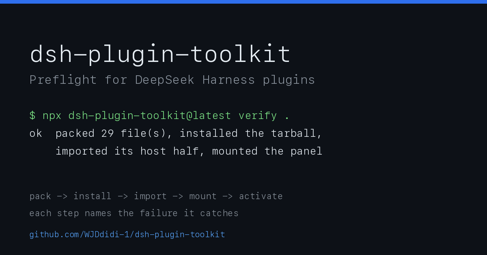

# dsh-plugin-toolkit



[English](./README.md) · 中文

一个 [DeepSeek Harness](https://github.com/deepseek-ai/dsh) 插件从 `init` 到被市场索引接受之间需要的一切：脚手架、客户端 bundle 的测试台、不重启应用就能看到改动的方法，以及一条不用背十四个步骤的发布流程。

```sh
npx dsh-plugin-toolkit@latest init ./my-panel --name my-panel   # 生成一个已经能通过检查的插件
npx dsh-plugin-toolkit@latest verify .                          # 打包、安装 tarball、真的把面板挂起来
npx dsh-plugin-toolkit@latest release --pr --merge              # 打 tag、等 npm、更新索引、开 PR 并合并
```

## 三条路径

| 你是谁 | 从这里开始 | 然后 |
| --- | --- | --- |
| 第一次写插件 | `init` | `doctor`、`verify` |
| 改一个已经装上的面板 | `dev` | `mount`、testkit、`audit` |
| 要发一个版本 | `verify` | `release`、`index` |

## 为什么会有这个工具

我发布自己第一个面板插件的那天，同一个错误在四个地方各出现一次，而且每次的报错都指向别处：

1. `package.json` 里 `exports["."]` 指向 CLI，插件装上了，加载器那行**什么都 apply 不到**；
2. `files` 忘了 `client.js`，`npm pack` 出来的包里没有面板代码，`doctor` 读工作副本看不出来；
3. 声明了 `dsh.client` 却没有 `exports["./client"]`，宿主直接把这一行丢掉，界面上只留一个红点「异常」，没有任何文字；
4. 客户端 apply 里没保护的 `ctx.locale.register(...)` 在服务就绪前抛错，**整个 web boot 失败**，应用把这判成「第三方插件不支持」并关掉所有插件。

每一条都能在发布前被机器拦住，所以每一条现在都是一项检查。这些检查对着**宿主的解析代码**写，而不是对着文件约定写——差别就是 `verify` 报 `mounted the panel` 而真实宿主什么都不加载。

## 安装要求

- Node.js 18 或更新（CI 在 18/20/22 × ubuntu/macos/windows 上跑）。
- 要发布时需要一个能写 `market/index.json` 的仓库和 `gh`（已登录）。

## 从一个已经能通过检查的插件开始

```sh
npx dsh-plugin-toolkit@latest init ./my-panel --name my-panel
cd my-panel && npm install && npm test
```

生成的项目里已经有了这些容易被忘掉的东西：

- `main` / `exports[".""]` 指向插件本体（`index.js`，导出 `apply`）；
- `exports["./client"]` 指向 `client.js`（**没有它宿主不服务这个 bundle**）；
- `dsh.client = { platform: "web", immediately: true }` 与 `dsh.bundle.patch`；
- `files` 覆盖上面每一个路径；
- 一份 `node --test` 用例和一个钉住本工具版本的 CI 工作流。

版本号取自当前运行的 CLI 自身，所以脚手架不会落后于你正在读的文档。

## 它在哪里

检查器固定在**对话栏下方、输入框上方**：默认收起成一行，点开就是完整指南——这是给谁用的、怎么用、每一项检查拦什么、以及它证明不了什么——下面才是文件夹输入框和结果。同一个面板也在右侧栏有一个 **Plugin doctor** 标签页，对话区忙的时候用那个。

面板中英双语，默认中文；**中文 / EN** 开关就在对话栏那一行的右侧（右侧栏标签里也有），选过之后会记住。

## 不用浏览器测面板

```js
import { createFetch, expectSnapshot, mountClient } from 'dsh-plugin-toolkit/testkit';

const panel = await mountClient({
  file: 'client.js',
  copy: { en: {} },
  fetch: createFetch({ '/toolkit/check': { body: { ok: true, checks: [] } } }),
});

await panel.type('.tk-input', '/tmp/plugin');
await panel.click('.tk-button');
console.log(panel.text());
await panel.unmount();
```

`mountClient` 用 jsdom 加载真实的单文件 bundle、注入宿主服务、把组件真的渲染出来。它提供 `type` / `click` / `press`（都返回 Promise）、`text()`、`query` / `queryAll` / `must`，以及 `aria(selector)` / `expectAria(selector, expected)`——后者让「读屏器看到的是什么」变成断言，而不是靠选择器猜。

### 留一份视觉基线

```js
await expectSnapshot(panel, { name: 'empty' });
```

第一次运行写入 `test/__snapshots__/empty.html` 与 `.aria.txt`；之后每次比较，差异会打印出来。

## 看看装了什么，以及应用到底加载了没有

```sh
npx dsh-plugin-toolkit@latest audit --host http://127.0.0.1:54133
```

它扫描 `~/.dsh/profiles/*/node_modules` 里所有声明了 `dsh` 的包，对每个跑 `doctor`，再从宿主的 `/plugins/events` 读取「应用真的加载了它吗」。输出把两类问题分开：

- **hard**：`root export` 没有 `apply`、`exports["./client"]` 缺失、patch 形状不对——这些会让插件不工作；
- **advisory**：缺 `engines.dsh`、README 没有 Requirements 段——市场索引要这些，加载器不读。

`7 installed plugin(s) are not in the running app` 和 `13 … not ready for the market index` 是两件事，混着数会让人去修根本不影响使用的东西。

## 改一个已经装上的插件

```sh
npx dsh-plugin-toolkit@latest dev ./my-plugin --host http://127.0.0.1:54133
```

它监听源码，把改动复制进 profile 的 `node_modules`，然后在宿主的 `/plugins/events` SSE 上等一帧 `rebuilt` 确认——只有真的重载了才算成功。如果预览显示 `the running app has not loaded <id>`，那是插件没被加载，重启一次应用即可，不是 dev 的问题。

## 在 CI 里用

```yaml
- uses: WJDdidi-1/dsh-plugin-toolkit@v1
  with:
    dir: .
    version: 0.9.5
```

默认跑 `verify`：打包、把 tarball 装进临时目录、import 根导出断言它有 `apply`、用裸 ctx 调一次 `apply({})` 确认服务缺失时降级而不是抛错、最后把面板挂起来。`doctor` 在读工作副本，`verify` 在读**用户真正会装到的东西**。

## `doctor` 检查什么

| 检查 | 拦住的是 |
| --- | --- |
| manifest | 没有 `name` / `version` / `engines.dsh` |
| root export | `exports["."]` 指向 CLI，加载器那行没有插件可 apply |
| client entry | 找不到 bundle，或 `dsh.client` 与 `exports["./client"]` 不一致 |
| client declaration | `platform` 不是 `web`、缺 `exports["./client"]`、指向的文件不存在 |
| files list | `npm pack` 不会带上 manifest 指到的路径 |
| patch | `cordis.patch.yml` 不是唯一一条 `- insert:` |
| readme | 没有 Requirements 段（advisory，市场索引要） |

`dsh-plugin-toolkit doctor .` 的退出码只由 hard 项决定。

## 面板不出现的时候

按顺序查这五件事：

1. **重启应用**——客户端 bundle 只在启动时加载；
2. 根导出是不是插件：`node -e "import('dsh-plugin-toolkit').then(m => console.log(typeof m.apply))"` 应为 `function`；
3. tarball 里有没有它：`npx dsh-plugin-toolkit verify .`；
4. `cordis.patch.yml` 是不是恰好一条 `- insert:`，`name` 与包名一致；
5. 面板自己有没有报错：`~/.dsh/toolkit-client-report.ndjson`（本插件的面板把激活失败写在这里，因为界面只有一个红点）。

## `release` 做什么

1. 预检版本、`engines.dsh`、README Requirements；
2. `git tag plugin-vX.Y.Z && git push origin plugin-vX.Y.Z`（`--publish` 时接着 `npm publish`）；
3. 轮询 npm registry 直到这个版本真的可下载（传播通常 2–8 分钟，`npm view` 有缓存，直接读 `versions`）；
4. 把 `market/index.json` 里该插件改成新版本 + 真实 `publishTimestamp`；
5. 在索引所在的仓库开 PR，`--merge` 时等 CI 全绿后 squash 合并；
6. 从 raw URL 复核线上索引确实变了。

索引在别人的仓库里时用 `--market <dir>`，它会对着那个目录做第 4–6 步。

## 还没有的

- 不做插件市场本身，也不代替 `dsh plugin add`；
- 不校验你的面板长得好不好看——视觉基线只负责「和上次一样」；
- Windows 上的路径与 `npm.cmd` 有专门的测试，但没有 Windows 实机手工验证。

## 许可

Apache-2.0。
